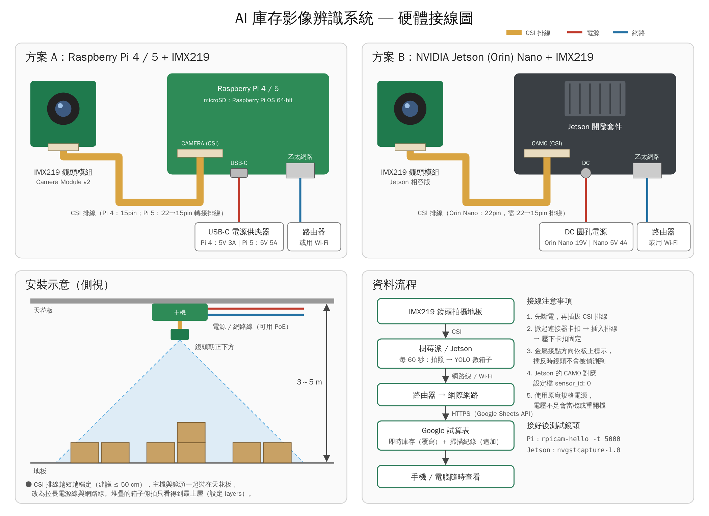

# 庫存影像辨識系統（地板箱數自動盤點）

用 **樹莓派 / NVIDIA Jetson + CSI 介面 IMX219 鏡頭** 拍攝倉庫地板，
**每一分鐘** 自動辨識箱子數量，並更新到 **Google 試算表**。開發環境用 **VS Code**。

```
 IMX219 鏡頭 ──► 拍照 ──► YOLO 偵測箱子 ──► 依地板區域計數 ──► 中位數平滑 ──► Google 試算表
   (CSI)       (每 60 秒)   (或輪廓偵測)      (A區、B區…)       (過濾人員遮擋)    ├ 即時庫存（覆寫）
                                                                                └ 掃描紀錄（追加）
```

## 專案結構

```
inventory_vision/
  app.py        主程式：排程、掃描流程、標註圖輸出
  camera.py     攝影機：picamera2（樹莓派）、GStreamer（Jetson）、USB、圖片檔
  detector.py   偵測器：YOLO（正式用）、輪廓偵測（不需訓練，初期測試用）
  zones.py      地板區域判斷、各區計數、平滑化
  sheets.py     Google 試算表寫入 + 斷網暫存補傳
  config.py     設定檔讀取
tools/
  calibrate_roi.py   在畫面上點選地板區域
  collect_images.py  定時拍照收集訓練資料
  train_yolo.py      訓練 / 匯出 YOLO 模型（TensorRT、NCNN）
config/config.example.yaml   設定檔範例（中文註解）
deploy/inventory-vision.service   開機自動執行（systemd）
.vscode/            VS Code 執行/除錯設定
tests/              單元測試
```

---

## 1. 硬體架設



（向量版：[docs/wiring.svg](docs/wiring.svg)）

| 項目 | 建議 |
|------|------|
| 主機 | Raspberry Pi 4/5（4GB 以上）或 Jetson Nano / Orin Nano |
| 鏡頭 | IMX219（Raspberry Pi Camera Module v2 或相容模組），廣角款（120°/160°）可涵蓋更大範圍 |
| 安裝位置 | **天花板正上方俯拍** 最準確（箱子不互相遮擋）；高度約 3～5 公尺 |
| 照明 | 固定照明，避免陽光直射造成反光與陰影變化 |

> ⚠️ 俯拍只看得到最上層。若箱子會堆疊，請在設定檔中為該區設定 `layers`（每疊固定層數），
> 或改為斜拍並把每一疊當成一個物件來訓練。

**確認鏡頭可用：**

```bash
# 樹莓派（Bookworm 之後）
rpicam-hello -t 5000          # 舊版系統為 libcamera-hello

# Jetson
gst-launch-1.0 nvarguscamerasrc sensor-id=0 ! nvvidconv ! xvimagesink
```

---

## 2. 安裝

### 樹莓派（Raspberry Pi OS 64-bit）

```bash
sudo apt update
sudo apt install -y python3-picamera2 python3-opencv python3-venv git
git clone <此儲存庫網址> ~/shei-wei && cd ~/shei-wei
# --system-site-packages：沿用系統安裝的 picamera2 與 OpenCV
python3 -m venv --system-site-packages .venv
.venv/bin/pip install -r requirements.txt
```

### NVIDIA Jetson（JetPack）

JetPack 內建的 OpenCV 才有 GStreamer 支援，**不要** 用 pip 安裝 opencv-python
（requirements.txt 已在 aarch64 上自動略過）。

```bash
git clone <此儲存庫網址> ~/shei-wei && cd ~/shei-wei
python3 -m venv --system-site-packages .venv
.venv/bin/pip install -r requirements.txt
```

> Jetson 上的 PyTorch 需安裝對應 JetPack 版本的 wheel，請參考
> Ultralytics 官方的 NVIDIA Jetson 安裝指南。

### 開發用電腦（Windows / macOS / Linux，用 VS Code 寫程式、跑測試）

```bash
python -m venv .venv
.venv/bin/pip install -r requirements-dev.txt      # Windows: .venv\Scripts\pip
.venv/bin/python -m pytest
```

---

## 3. VS Code 開發流程

1. 安裝建議擴充套件（開啟專案時 VS Code 會提示）：Python、Remote - SSH、YAML。
2. **Remote - SSH** 連到樹莓派 / Jetson：`F1` → `Remote-SSH: Connect to Host` → `pi@<IP>`，
   直接在裝置上編輯與執行程式。
3. 左側「執行與偵錯」已預先設定：
   - **掃描一次（不寫入試算表）**：測試鏡頭與偵測結果，結果圖存在 `data/latest.jpg`，可直接在 VS Code 中開啟查看
   - **持續監測（每分鐘更新試算表）**
   - **設定地板區域 (ROI)**
4. 測試頁籤可直接執行 `tests/` 中的單元測試。

---

## 4. Google 試算表設定

1. 到 [Google Cloud Console](https://console.cloud.google.com/) 建立專案，
   啟用 **Google Sheets API** 與 **Google Drive API**。
2. 「IAM 與管理」→「服務帳戶」→ 建立服務帳戶 → 「金鑰」→ 新增 JSON 金鑰，
   下載後存為 `credentials/service_account.json`（此資料夾已被 git 忽略）。
3. 建立一份 Google 試算表，按「共用」，把 **服務帳戶的 email**（`xxx@xxx.iam.gserviceaccount.com`）加為 **編輯者**。
4. 複製試算表網址 `https://docs.google.com/spreadsheets/d/<這段就是ID>/edit` 中的 ID，
   填入設定檔的 `google_sheets.spreadsheet_id`。

程式會自動建立兩個工作表：

**即時庫存**（每分鐘覆寫）

| 區域 | 箱數 | 原始偵測數 | 更新時間 |
|------|------|-----------|----------|
| A區 | 24 | 24 | 2026-10-13 14:05:00 |
| B區 | 18 | 9 | 2026-10-13 14:05:00 |
| 合計 | 42 | 33 | 2026-10-13 14:05:00 |

**掃描紀錄**（每分鐘追加，可用來畫趨勢圖、計算進出貨）

| 時間 | 區域 | 箱數 | 原始偵測數 |
|------|------|------|-----------|

- 「箱數」= 平滑後偵測數 × `layers`；「原始偵測數」= 該次實際辨識到的框數。
- 網路中斷時紀錄會暫存在 `data/pending_rows.jsonl`，恢復連線後自動補上傳。
- 每天約 1,440 次 × 區域數 列；若只想記錄變化，設定 `log_only_on_change: true`。

---

## 5. 設定與校正

```bash
cp config/config.example.yaml config/config.yaml
```

1. **先用輪廓偵測測試鏡頭位置**：`detector.type: contour`，執行
   `python -m inventory_vision --once --dry-run`，查看 `data/latest.jpg`。
2. **設定地板區域**：`python tools/calibrate_roi.py`（需螢幕/VNC），
   或在電腦上對拍好的圖片執行 `python tools/calibrate_roi.py --image data/latest_raw.jpg`。
   左鍵點頂點、`n` 下一區、`s` 儲存，把輸出貼進 `config.yaml` 的 `zones`。
   不在任何區域內的箱子（走道、貨架）不會被計算。

---

## 6. 訓練箱子辨識模型（建議）

通用的 YOLO 預訓練模型沒有「紙箱」類別，需要用自己倉庫的照片訓練，準確度會遠高於輪廓偵測。

1. **收集照片**（在裝置上）：
   `python tools/collect_images.py --count 300 --interval 60`
   盡量涵蓋不同時段光線、不同堆放狀況、有人經過的畫面。
2. **標註**：用 Roboflow / CVAT / Label Studio 框出每個箱子（類別 `box`），匯出 **YOLO 格式**。
3. **訓練**（在有 GPU 的電腦或 Google Colab）：
   `python tools/train_yolo.py --data datasets/boxes/data.yaml --epochs 100`
   將 `runs/detect/train/weights/best.pt` 複製到裝置的 `models/boxes.pt`。
4. **加速（選用）**：
   - Jetson：`python tools/train_yolo.py --export models/boxes.pt --format engine` → 使用 `models/boxes.engine`
   - 樹莓派：`python tools/train_yolo.py --export models/boxes.pt --format ncnn` → 使用 `models/boxes_ncnn_model`
5. 設定檔改回 `detector.type: yolo`、`model_path` 指向模型檔。

每分鐘只需推論一張圖，樹莓派 4/5 用 CPU 跑 yolo11n 也綽綽有餘（約 0.5～2 秒）。

---

## 7. 執行

```bash
.venv/bin/python -m inventory_vision -c config/config.yaml --once --dry-run   # 測試一次
.venv/bin/python -m inventory_vision -c config/config.yaml                    # 每分鐘持續更新
```

**開機自動執行**（修改 service 檔中的使用者與路徑後）：

```bash
sudo cp deploy/inventory-vision.service /etc/systemd/system/
sudo systemctl daemon-reload
sudo systemctl enable --now inventory-vision
journalctl -u inventory-vision -f      # 查看即時紀錄
```

---

## 8. 準確度建議

- `smoothing_window: 3`：取最近 3 次（3 分鐘）的中位數，人員或堆高機短暫經過不會讓數字跳動；
  想反應更快可設 1，想更穩定可設 5。
- 誤判太多 → 提高 `confidence`；漏抓太多 → 降低 `confidence` 或增加訓練資料。
- 箱子緊密相鄰時，俯拍 + YOLO 的效果比輪廓偵測好很多。
- 夜間無照明時可考慮補光燈，或在 IMX219 NoIR 版本搭配紅外線燈。

## 疑難排解

| 問題 | 解法 |
|------|------|
| Jetson「無法開啟攝影機」 | 確認使用 JetPack 內建 OpenCV（`python3 -c "import cv2; print(cv2.getBuildInformation())"` 中 GStreamer 為 YES）；`sudo systemctl restart nvargus-daemon` |
| 樹莓派找不到鏡頭 | `rpicam-hello --list-cameras`；檢查排線方向；Pi 5 需使用 22pin 轉接排線 |
| 試算表 403 / PERMISSION_DENIED | 試算表沒有共用給服務帳戶 email，或未啟用 Sheets/Drive API |
| 數字一直是 0 | 查看 `data/latest.jpg`：藍色框為區域、綠色框為偵測結果，確認區域座標與鏡頭解析度一致 |
